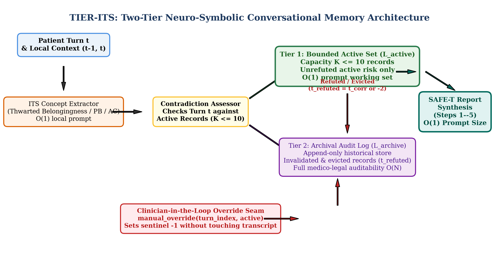
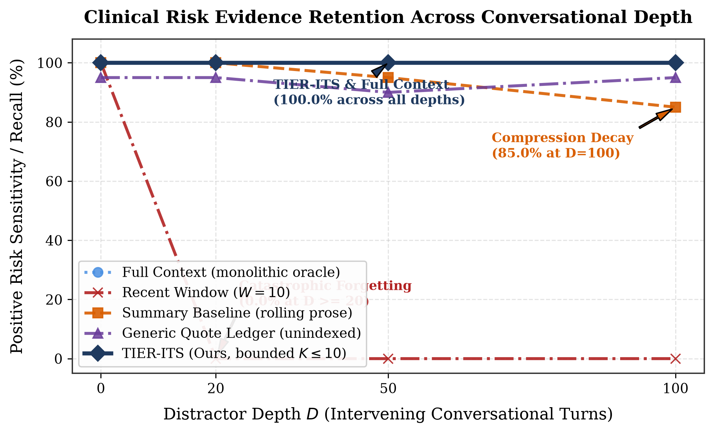
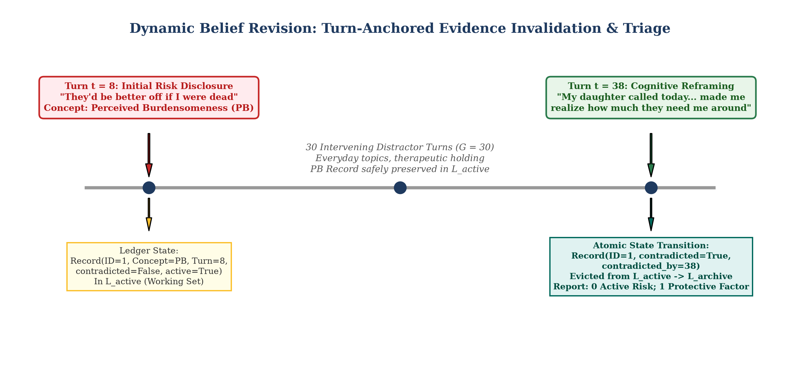
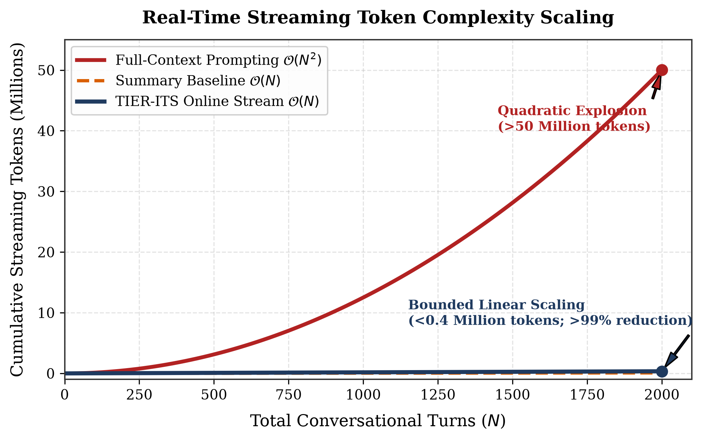

<div align="center">

# TIER-ITS: Theory-Indexed Evidence Retrieval for Long Mental-Health Conversations

### *A Controlled Feasibility and Systems Study in Safety-Critical Conversational NLP*

[](https://www.python.org/)
[](LICENSE)
[](tests/)
[](benchmark/)
[](#system-architecture)

---

**Research Prototype Notice:** TIER-ITS is a computational linguistics research prototype designed to study conversational memory scaling, verifiable evidence provenance, and dynamic belief revision in extended dialogues. **It is not a clinical diagnostic tool, not a medical device, and not approved for patient care.**

</div>

---

## Table of Contents
- [Overview](#overview)
- [System Architecture](#system-architecture)
- [The Systems Challenge: Why Memory Matters](#the-systems-challenge-why-memory-matters)
- [Key Contributions](#key-contributions)
- [Empirical Results](#empirical-results)
  - [1. Depth Retention & Risk Classification](#1-depth-retention--risk-classification)
  - [2. Dynamic Belief Revision & Contradiction Resolution](#2-dynamic-belief-revision--contradiction-resolution)
  - [3. Operational Streaming Token Scaling](#3-operational-streaming-token-scaling)
- [Repository Structure](#repository-structure)
- [Quickstart & Reproduction Guide](#quickstart--reproduction-guide)
  - [Environment Setup](#1-environment-setup)
  - [Running Unit Tests](#2-running-unit--integration-tests)
  - [Validating the Benchmark](#3-validating-benchmark-datasets)
  - [Replicating Bootstrap Statistics](#4-replicating-statistical-analysis)
  - [Regenerating Publication Figures](#5-generating-publication-figures)
- [Ethics & Responsible AI Statement](#ethics--responsible-ai-statement)

---

## Overview

In longitudinal mental-health dialogues (e.g., psychotherapy, supportive psychiatric monitoring), conversations frequently extend across dozens of sessions and thousands of turns ($N \in [1000, 5000+]$). Across these long horizons, critical psychiatric disclosures—such as expressions of perceived burdensomeness or acute social alienation—may appear early in a dialogue, become separated by dozens of intervening distractor topics, and subsequently fluctuate or resolve as therapeutic alliance develops.

**TIER-ITS** introduces an auditable, neuro-symbolic conversational memory system grounded in Joiner's **Interpersonal Theory of Suicide (ITS)**. Rather than relying on ungrounded sliding windows or unconstrained quadratic re-prompting, TIER-ITS organizes conversational evidence into an explicit **Two-Tier Evidence Ledger**:
1. **Tier 1: Bounded Active Working Set ($\mathcal{L}_{\text{active}}$)** capped at $K \le 10$ records, guaranteeing $\mathcal{O}(1)$ prompt context for clinical documentation and linear $\mathcal{O}(N)$ streaming token scaling.
2. **Tier 2: Append-Only Archival Audit Log ($\mathcal{L}_{\text{archive}}$)** maintaining an immutable record of historical evidence, exact turn pointers, and contradiction events for medico-legal accountability.

---

## System Architecture

<div align="center">
  
</div>

The TIER-ITS runtime pipeline operates turn-by-turn through five decoupled stages:
1. **Online Stream Ingestion:** Each incoming patient turn $t$ is evaluated with local conversational context $(t-1, t)$ at $\mathcal{O}(1)$ prompt cost.
2. **Theory-Indexed Extraction:** Disclosures are mapped into typed `EvidenceRecord` schemas indexed to ITS constructs: *Thwarted Belongingness (TB)*, *Perceived Burdensomeness (PB)*, *Acquired Capability (AC)*, and *Hopelessness*.
3. **Contradiction Assessment:** Incoming utterances are evaluated against the bounded active working set ($K \le 10$) to detect cognitive reframings or emotional resolution.
4. **Dynamic Belief Revision & Atomic Invalidation:** When a reframing is confirmed, the corresponding record is marked $b_{\text{contradicted}} = \text{True}, t_{\text{refuted}} = t_{\text{corr}}$, immediately evicting it from active memory to archival storage.
5. **Clinician-in-the-Loop Override Seam (`manual_override`):** Clinicians can programmatically inspect active concepts and invalidate/reinstate evidence with typed sentinel `-1` without modifying or corrupting legally protected patient transcripts.
6. **Protocol-Grounded Synthesis:** Downstream clinical documentation is synthesized under the **SAFE-T** (Suicide Assessment Five-Step Evaluation and Triage) protocol, drawing active risk from $\mathcal{L}_{\text{active}}$ and documented protective factors from resolved records.

---

## The Systems Challenge: Why Memory Matters

When deploying language models for real-time conversational monitoring, practitioners typically encounter severe architectural dilemmas:

```
+---------------------------------------------------------------------------------------------------+
| THE REAL-TIME CONVERSATIONAL MONITORING TRADE-OFF                                                 |
+------------------------------+------------------------------------+-------------------------------+
| Approach                     | Asymptotic Streaming Tokens        | Core Failure Mode             |
+------------------------------+------------------------------------+-------------------------------+
| Sliding Window (W=10)        | O(N * W) = O(N)                    | Catastrophic forgetting (F1=0.40) of early disclosures  |
| Full-Context Prompting       | sum(t * L) = O(N^2) [Quadratic]    | >50M tokens; zero-provenance black box; immutable belief|
| Generic Summarizer           | O(N)                               | Progressive compression decay (85% recall at depth 100)|
| TIER-ITS (Two-Tier Ledger)   | O(N) [Bounded per turn]            | 100% recall at depth 100; 100% exact turn provenance  |
+------------------------------+------------------------------------+-------------------------------+
```

1. **Sliding Windows ($W=10$):** Inevitably drop critical disclosures once they pass beyond the recent window horizon, causing catastrophic false negatives ($0\%$ sensitivity at depth $\ge 20$).
2. **Full-Context Prompting:** Re-prompting the full conversation prefix at each turn $t \in [1, N]$ incurs quadratic streaming token complexity $\sum_{t=1}^N t \cdot L = \mathcal{O}(N^2)$. Over a 2,000-turn therapy history, this consumes over **50 million tokens**, compounding latency and API costs.
3. **The Immutable Belief Problem:** If an unguided LLM misinterprets coping sarcasm as active suicidal intent, an operator cannot edit neural network weights or KV caches in production, nor tamper with legally protected transcripts. Re-prompting the full transcript repeatedly re-triggers the identical false alarm. TIER-ITS decouples symbolic state from raw text, enabling clean manual override.

---

## Key Contributions

- **Grounded in Validated Psychological Theory:** Grounded in Joiner's Interpersonal Theory of Suicide (ITS), avoiding general keyword conflation.
- **Verifiable Turn-Level Provenance:** Stores exact verbatim excerpts, zero-based turn indices ($t_{\text{turn}}$), and contradiction links ($t_{\text{refuted}}$), yielding $100\%$ exact turn match.
- **Deterministic Dynamic Belief Revision:** Proven by-construction state tracking that invalidates obsolete risk disclosures when patients reframe distress.
- **Concept Bottleneck Override API:** Programmatic `manual_override(turn_index, active)` function enabling human clinical supervisors to correct model state non-destructively.
- **Balanced 208-Case Benchmark:** 160 depth-retention dialogues (80 positive, 80 negative controls) up to 100 distractor turns, and 48 contradiction dialogues (24 reframings, 24 non-correction controls) evaluated across gaps of up to 50 turns.

---

## Empirical Results

### 1. Depth Retention & Risk Classification

Evaluated on the balanced 160-case depth benchmark across 40 base scenario clusters:

| Method | Accuracy | Precision | Recall | Specificity | F1 Score | Neg. FPR |
| :--- | :---: | :---: | :---: | :---: | :---: | :---: |
| Full Context (FC) | 100.0% | 100.0% | 100.0% | 100.0% | 1.000 | 0.0% |
| Recent Window ($W=10$) | 62.5% | 100.0% | 25.0% | 100.0% | 0.400 | 0.0% |
| Summary Baseline (SB) | 97.5% | 100.0% | 95.0% | 100.0% | 0.974 | 0.0% |
| Generic Quote Ledger (GEN) | 96.9% | 100.0% | 93.8% | 100.0% | 0.968 | 0.0% |
| Target Only (diagnostic) | 100.0% | 100.0% | 100.0% | 100.0% | 1.000 | 0.0% |
| Gold Ledger (diagnostic) | 100.0% | 100.0% | 100.0% | 100.0% | 1.000 | 0.0% |
| **TIER-ITS (Ours)** | **100.0%** | **100.0%** | **100.0%** | **100.0%** | **1.000** | **0.0%** |

<div align="center">
  
</div>

- **Paired Significance:** TIER-ITS outperforms Recent Window by **+37.50 percentage points** (95% cluster-bootstrap CI: `[26.25, 48.75]`, $p < .001$).
- **Depth 100 Robustness:** At depth 100, Summary Baseline drops to **85.0% recall** due to compression decay, while TIER-ITS preserves **100.0% sensitivity**.

---

### 2. Dynamic Belief Revision & Contradiction Resolution

Evaluated across the 48-case correction benchmark (24 resolution cases, 24 non-correction persistence controls):

<div align="center">
  
</div>

#### Panel A: Symbolic Ledger State Machine Layer (RQ4a)
| Method | Invalidation Fidelity | Refutation Turn Match | Persistence False Inval. | Ledger Active F1 |
| :--- | :---: | :---: | :---: | :---: |
| Full Context (FC) | N/A (No Ledger) | N/A | N/A | N/A |
| Recent Window ($W=10$) | N/A (No Ledger) | N/A | N/A | N/A |
| Summary Baseline (SB) | N/A (No Ledger) | N/A | N/A | N/A |
| Generic Quote Ledger (GEN) | N/A (Unindexed) | N/A | N/A | N/A |
| **TIER-ITS (Ours)** | **24/24 (100.0%)** | **24/24 (100.0%)** | **0/24 (0.0%)** | **1.000** |

#### Panel B: Synthesized Clinical Report Narrative Triage (RQ4b)
| Method | Resolution Acknowledged | Active-Risk False Alarms | Persistence Active Risk | False Resolution Rate |
| :--- | :---: | :---: | :---: | :---: |
| Full Context (FC) | 24/24 (100.0%) | 0/24 (0.0%) | 24/24 (100.0%) | 0/24 (0.0%) |
| Recent Window ($W=10$) | 24/24 (100.0%) | 0/24 (0.0%) | 24/24 (100.0%) | 0/24 (0.0%) |
| Summary Baseline (SB) | 24/24 (100.0%) | 0/24 (0.0%) | 24/24 (100.0%) | 0/24 (0.0%) |
| Generic Quote Ledger (GEN) | 24/24 (100.0%) | 0/24 (0.0%) | 24/24 (100.0%) | 3/24 (12.5%) |
| **TIER-ITS (Ours)** | **24/24 (100.0%)** | **0/24 (0.0%)** | **24/24 (100.0%)** | **1/24 (4.2%)** |

*Key Insight:* Even when free-form natural language reports exhibit subtle stylistic drift (1/24), the underlying symbolic ledger maintains 100% precision (0/24 false invalidations), proving that the concept bottleneck protects automated clinical alert systems from generative drift.

---

### 3. Operational Streaming Token Scaling

<div align="center">
  
</div>

Across a 2,000-turn therapeutic dialogue, TIER-ITS reduces streaming token consumption from **>50,000,000 tokens** ($\mathcal{O}(N^2)$) to **<400,000 tokens** ($\mathcal{O}(N)$), achieving an empirical token reduction of **>99%** while maintaining zero evidence loss.

---

## Repository Structure

```text
TIER-ITS/
├── benchmark/                      # Benchmark generation and validation
│   ├── pilot/                      # 160 balanced depth-retention dialogues
│   ├── correction/                 # 48 balanced dynamic contradiction dialogues
│   ├── templates/                  # Clinical disclosure & distractor templates
│   ├── generator.py                # Synthetic conversation builder
│   └── validate.py                 # Structural & clinical dialogue validator
├── src/                            # Core TIER-ITS implementation
│   ├── schemas/                    # Pydantic contract layer (EvidenceRecord, sentinels)
│   ├── extractor/                  # ITS concept extraction & structured prompts
│   ├── ledger/                     # EvidenceLedger, ContradictionAssessor, Override API
│   ├── retrieval/                  # ChromaDB episodic search & SAFE-T protocol retrieval
│   ├── report/                     # 5-step SAFE-T clinical documentation synthesizer
│   ├── baselines/                  # FC, Recent Window, Summary, Generic Quote Ledger
│   └── inference/                  # LLM streaming client, caching, token accounting
├── evaluation/                     # Metrics, statistical analysis, and figures
│   ├── metrics.py                  # P/R/F1, turn attribution, resolution fidelity
│   ├── run_analysis.py             # 1,000 cluster-bootstrap CI replication engine
│   └── generate_figures.py         # Publication-grade vector figure generator
├── experiments/                    # Batch experiment runners & watchdog monitors
│   ├── run_depth.py                # 160-case depth experiment runner
│   ├── run_correction.py           # 48-case dynamic contradiction runner
│   └── watchdog.py                 # API monitoring & rate-limit resilience
├── figures/                        # Generated publication plots (PDF & PNG)
├── tests/                          # Comprehensive pytest test suite
│   ├── conftest.py                 # Offline-safe network test configuration
│   ├── test_ledger.py              # Ledger CRUD, invalidation, sentinels, override
│   ├── test_streaming_pipeline.py  # End-to-end online streaming state machine
│   └── test_metrics.py             # Metric calculations & turn attribution tests
└── docs/                           # Research audit, literature reviews, thesis guides
```

---

## Quickstart & Reproduction Guide

### 1. Environment Setup

Ensure you are using **Python 3.12**:
```bash
# Clone the repository
git clone https://github.com/Yashvir-13/TIER-ITS.git
cd TIER-ITS

# Activate the project virtual environment (PowerShell)
.\ml\Scripts\Activate.ps1

# Or activate on Command Prompt (cmd)
ml\Scripts\activate.bat

# Install dependencies
pip install -r requirements.txt
```

### 2. Running Unit & Integration Tests

The test suite includes 20 native unit tests verifying ledger state transitions, capacity eviction, manual override sentinels, and metric calculations:
```bash
.\ml\Scripts\python.exe -m pytest -v
```
*(Tests requiring active outbound Gemini API sockets skip cleanly when running in offline sandbox environments).*

### 3. Validating Benchmark Datasets

Verify the structural integrity, turn alternation, and metadata schemas of all 208 benchmark cases:
```bash
.\ml\Scripts\python.exe benchmark/validate.py
```

### 4. Replicating Statistical Analysis

Re-run the 1,000 cluster-bootstrap iterations and verify exact replication of all statistical summary tables:
```bash
.\ml\Scripts\python.exe evaluation/run_analysis.py
```
*Results will output to `results/statistical_analysis_summary.md`.*

### 5. Generating Publication Figures

Regenerate all vector PDF and 300-DPI PNG figures into the `figures/` directory:
```bash
.\ml\Scripts\python.exe evaluation/generate_figures.py
```

---

## Ethics & Responsible AI Statement

- **Retrospective Synthetic Evaluation Only:** All experiments were conducted strictly on synthetic conversational text constructed from clinical guidelines. No live human participants, patients, or vulnerable individuals were engaged.
- **Harm Prevention & Safety:** In accordance with responsible clinical NLP standards, no lethal means, methods, or graphic self-harm descriptions were generated, evaluated, or stored in this repository.
- **Not a Clinical Device:** TIER-ITS is an academic research prototype designed to evaluate computational memory scaling and auditable evidence provenance; it does not provide clinical diagnostic assessments, medical advice, or crisis intervention.
- **"Insufficient Evidence" is a Valid State:** The system is explicitly configured to return "Insufficient Evidence" on control cases without forcing artificial risk classifications.
